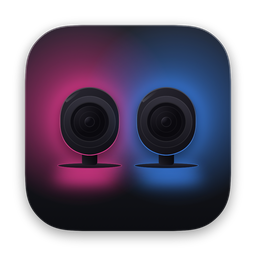
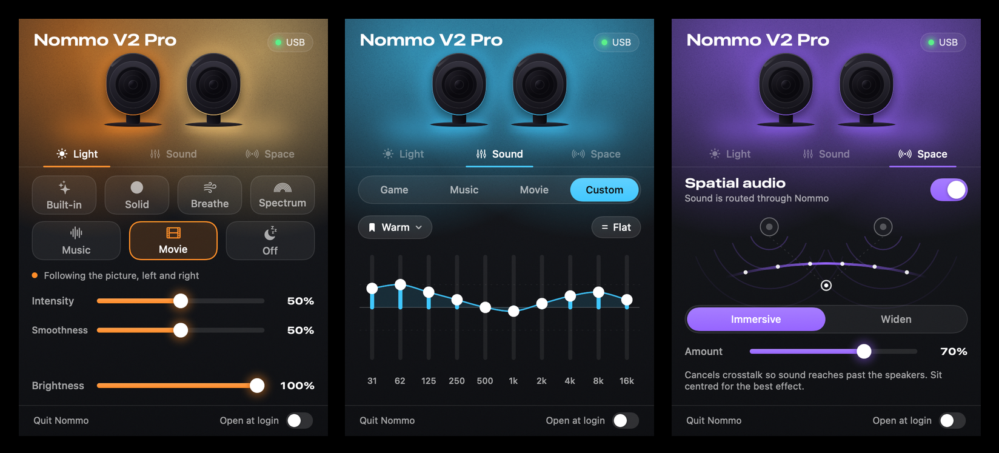
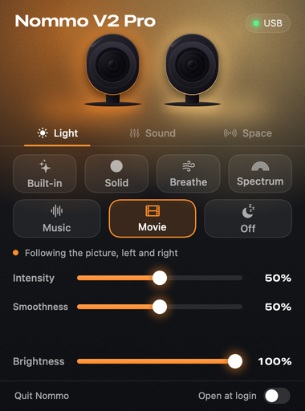
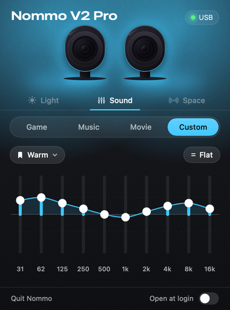
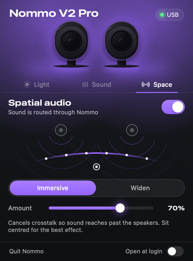

<p align="center">
  
</p>

<h1 align="center">Nommo for Mac</h1>

<p align="center">
  Lighting, EQ and spatial audio for the Razer Nommo V2 Pro, from your Mac's menu bar.
</p>

<p align="center">
  
</p>

> **This is an unofficial, independent project. It is not made, endorsed, sponsored or supported by Razer.**
> "Razer", "Nommo", "Synapse", "Chroma" and "THX" are trademarks of their respective owners and are used here only to
> say which hardware this works with.

## Why this exists

The Razer Nommo V2 Pro is a good pair of desktop speakers with a lot of nice features, and on a Mac you can't use any
of them. Razer's Synapse software does the lighting and EQ, but it is Windows-only for this product: Razer's recent Synapse for
Mac did not recognise these speakers when it was tried. On a Mac they work as plain USB speakers stuck on their default
colour cycle.

So this app was built to fix that. It talks to the speakers directly over USB, using a protocol worked out by watching
what Synapse sends them. See [docs/PROTOCOL.md](docs/PROTOCOL.md) if you are interested in how.

## What it does

- **Lighting.** Solid colours (a different one per speaker if you like), a two-colour Breathe, Spectrum, and a Music
  mode that makes the lights follow whatever is playing. Brightness control.
- **Equaliser.** The speaker's built-in presets (Game, Music, Movie) and a ten-band Custom EQ that runs on the
  speaker itself, with named profiles you can save and switch between.
- **Spatial audio.** An original stereo effect for two close speakers: crosstalk cancellation that makes the sound
  reach past the speakers, or a simple widener. This is **not THX**; see [below](#spatial-audio-and-thx).
- **Lives in the menu bar.** Optional launch at login. A `nommoctl` command-line tool is included too.

<table>
<tr>
<td></td>
<td></td>
<td></td>
</tr>
</table>

## Install

**You need:** a Nommo V2 Pro connected by **USB**, and a Mac running macOS 14.2 or later. The app is a universal binary
(Apple silicon and Intel), but it has only been run on Apple silicon.

1. Download the latest `Nommo-<version>.dmg` from the [**Releases page**](https://github.com/aderiz/nommo-mac/releases/latest),
   open it, and drag **Nommo** into **Applications**.
2. Open Nommo. A speaker icon appears in the menu bar; click it.

### Is it safe to open?

The release is signed with a Developer ID certificate and **notarised by Apple**, so macOS checks it and opens it
without any warnings beyond the usual one for apps downloaded from the internet (*"Nommo is an app downloaded from the
Internet. Are you sure you want to open it?"*, which you confirm with **Open**).

Notarisation means Apple scanned the build for known malware; it does not mean Apple has reviewed or endorses the app.
If you would rather not run a downloaded binary at all, **build it yourself**; it takes a minute (see
[Building from source](#building-from-source)). The source is all here, and each release lists the SHA-256 checksum of
its DMG so you can check what you downloaded.

### Permissions

- **System Audio Recording**: asked for the first time you turn on **Spatial audio** or the **Music** lighting
  effect. Both work by listening to the sound your Mac is playing (Spatial audio also plays it back after processing).
  Nothing is recorded, stored or sent anywhere. Without the permission, lighting colours, brightness and EQ still work.
- Nothing else. The speaker is controlled over a standard USB HID connection, which needs no special permission.

## Using it

Click the menu-bar icon.

- **Light.** Choose an effect. *Solid* takes a colour for each speaker (use the link button to set both at once).
  *Breathe* asks for two colours and fades between them. *Spectrum* cycles through the rainbow. *Music* reacts to
  what's playing, either as a pulse in your colours or as bass, mid and treble mapped to red, green and blue.
  *Built-in* hands the lights back to the speaker's own colour cycle. The interface itself takes its accent colour
  from the colour you pick.
- **Sound.** Pick a preset, or choose **Custom** to shape ten bands. Drag a fader, double-click to zero a band,
  and save the curve as a named profile from the bookmark menu. The built-in presets are tuned inside the speaker, which
  does not tell the app what their curves are, so they are shown as presets only.
- **Space.** Turn spatial audio on and choose **Immersive** (crosstalk cancellation) or **Widen**. Sit centred in front
  of the speakers for Immersive.

Because colours and animations are streamed to the speaker from your Mac (that is how Synapse does it too), **the app
needs to stay running** for custom lighting. Choose *Built-in* or quit the app and the speakers go back to their own
colour cycle.

### Command line

```sh
nommoctl info                      # serial, brightness, EQ bands
nommoctl color 255 0 128 10        # hold a colour for 10 seconds
nommoctl effect spectrum 15
nommoctl brightness 128
```

Build it with `swift build --product nommoctl`. It's a development tool; the app is the main way to use this.

## If something doesn't work

Run this in Terminal. It checks that the speaker can be opened and that system audio capture is allowed, and it
prints nothing that identifies you or your speaker:

```sh
/Applications/Nommo.app/Contents/MacOS/Nommo --diagnose
```

- **"speaker: not found"**: it isn't plugged in over USB, or it is on another input.
- **"found but could not be opened"**: Razer Synapse, or a virtual machine with the speaker attached, has it.
- **"system audio tap: failed"**: allow Nommo under System Settings → Privacy & Security → System Audio Recording
  (only Spatial audio and the Music lighting effect need it).

## Compatibility

| Speaker | Status |
|---|---|
| Razer Nommo V2 Pro (`1532:055A`) | Developed and tested on this one |
| Razer Nommo V2 (`1532:055C`) | Untested. Probably the same chipset and protocol. |
| Razer Nommo V2 X (`1532:055E`) | Untested. It has no lighting. |
| Older Nommo, Nommo Pro, Nommo Chroma | Different hardware; not supported |

Tested on Apple silicon with macOS 27. If you have one of the untested models and try this, please open an issue
using the *device report* template and say what worked. Even "nothing happened" is useful.

## Notes and limits

- **Spatial audio and THX.** The THX Spatial Audio option in Synapse is a Windows audio effect that runs on the PC;
  it isn't something the speaker does, so it can't be switched on from a Mac. The Space tab is an independent effect
  written for this project and makes no attempt to copy THX.
- **Only one app can control the speaker at a time.** Quit Synapse, and any virtual machine that has the speaker
  attached, before opening Nommo. If it can't connect, the app says so.
- **Audio source.** There is deliberately no control for switching the speaker's input (USB, Bluetooth and so on):
  getting it wrong can drop the USB connection until you press the speaker's own button.
- **Presets' curves.** Game, Music and Movie can be selected but their curves can't be read back from the speaker.
- **Not tested over a power cycle:** whether the speaker remembers a custom EQ curve after it is switched off.

## Building from source

You need Xcode 16 or later (the Swift 6 toolchain) on macOS 14.2 or later.

```sh
git clone https://github.com/aderiz/nommo-mac.git
cd nommo-mac

swift build                    # the library, the menu-bar app and the CLI
swift test                     # unit tests (no speaker needed)

./scripts/build_app.sh         # builds dist/Nommo.app
./scripts/install_app.sh       # builds, installs into /Applications and launches it
./scripts/make_dmg.sh          # builds Releases/Nommo-<version>.dmg
```

**Signing.** `build_app.sh` signs with an *Apple Development* or *Developer ID* certificate if it finds one in
your keychain, and otherwise falls back to an ad-hoc signature (or set `NOMMO_SIGN_IDENTITY`). Use a real certificate if
you can: macOS ties the System Audio Recording permission to the app's signing identity, and an ad-hoc signature
changes with every build, so you would be asked for the permission again after each rebuild.

### Layout

| Path | What's in it |
|---|---|
| `Sources/NommoKit` | The core library: packets, HID transport, device commands, lighting engine, effects, audio taps and DSP. No UI. |
| `Sources/NommoUI` | The SwiftUI interface and app state. |
| `Sources/NommoApp` | The menu-bar app entry point. |
| `Sources/nommoctl` | The command-line tool. |
| `Sources/NommoSnapshot` | Renders the interface to PNGs (used for the screenshots above and to review design changes without clicking through it). |
| `Tests/NommoKitTests` | Unit tests, including packets captured from Synapse. |
| `docs/PROTOCOL.md` | What is known about the speaker's USB protocol. |
| `research/` | Python scripts used while working the protocol out. |
| `scripts/` | Build, install, icon and DMG scripts. |

## Contributing

Issues and pull requests are welcome; see [CONTRIBUTING.md](CONTRIBUTING.md). The most useful contributions right now:

- Trying it on a **Nommo V2** or other model and reporting what happens.
- The real curves behind the **Game, Music and Movie** presets.
- Apple notarisation, if someone with a Developer ID wants to help ship signed releases.

## Licence

[MIT](LICENSE). This project contains no Razer software, drivers, firmware or artwork. The speaker drawings in the
interface are original illustrations.
